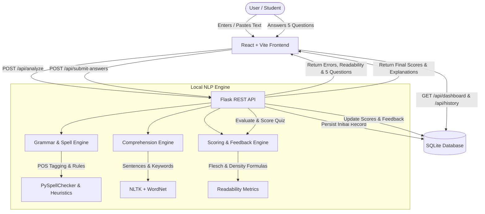

# Readify – AI-Powered Reading Comprehension & Grammar Assistant

> **Project Timeline for Resume:** February 2025 – December 2025  
> **Status:** Production-Ready Full-Stack Web Application  
> **Licensing & Cost:** 100% Free & Open-Source (Zero Paid APIs, Zero Subscriptions, No Credit Card Required)

---

## 1. Project Overview

**Readify** is a modern, student-centric AI reading assistance and literacy platform. It empowers students, educators, and lifelong learners to improve English reading comprehension, refine grammar and syntax accuracy, enrich vocabulary, and track reading velocity.

Users simply enter or paste any English passage (or choose from instant curated academic samples). In seconds, Readify's local NLP engine:
1. Detects spelling, punctuation, capitalization, repeated words, and subject-verb agreement errors.
2. Generates an auto-corrected passage with instant side-by-side comparison and 1-click clipboard copying.
3. Dynamically generates **5 passage-based multiple choice comprehension questions** (spanning main ideas, factual details, vocabulary in context, cause/effect relations, and inferences).
4. Calculates verifiable scores based on documented mathematical formulas (Grammar Accuracy, Comprehension Percentage, Flesch Reading Ease, and Flesch-Kincaid Grade Level).
5. Delivers personalized, contextual feedback based on the user's specific answers and error categories.
6. Persists reading activities and metrics in a lightweight local **SQLite database** to visualize historical score trends on an interactive SaaS dashboard.

---

## 2. Key Features

- **Interactive Reading Workspace:** Clean, distraction-free environment with live character counter, word counter, and estimated reading time.
- **Smart Grammar Correction:** Comprehensive local rule and statistical engine (detects subject-verb disagreements, punctuation spacing, confused homophones like *their/there*, article mistakes *a/an*, and spelling via Levenshtein distance).
- **Extractive & Contextual Comprehension Engine:** Generates 5 distinct questions per passage with plausible distractors and passage citations.
- **Measurable & Documented Scoring:** Transparent calculation formulas for Grammar (error density penalty), Comprehension (% correct), and Flesch Readability.
- **Personalized Feedback Engine:** Generates specific recommendations tailored to the student's quiz performance and error types (e.g., vocabulary tips, subject-verb rules, main idea strategies).
- **SaaS Analytics Dashboard:** Visualizes overall reading proficiency, historical score progression using responsive area charts (`Recharts`), and recent activities.
- **Reading History & Inspection Modal:** Searchable past analyses with deep inspection of original vs. corrected texts, quiz answers, and deletion confirmation dialogs.
- **1-Click Preset Samples:** Ready-to-test passages spanning technology, environmental science, psychology, and common student errors for immediate demonstration.
- **100% Local-First & Privacy-Focused:** No user text is sent to third-party commercial servers or paid APIs.

---

## 3. Technology Stack

| Layer | Technologies Used | Rationale / Purpose |
| :--- | :--- | :--- |
| **Frontend** | React 19, Vite 8 | Fast HMR development, modular components, lightweight bundle |
| **Styling** | Custom CSS3 Design System, Modern Glassmorphism | Indigo/lavender palette inspired by Linear & Notion; fully responsive down to 320px mobile |
| **Icons & Visuals** | `lucide-react`, `canvas-confetti` | Accessible vector icons and celebratory animations |
| **Charts** | `recharts` | Responsive area and line charts for score trends |
| **Backend** | Python Flask 3.0, Flask-CORS | Lightweight, robust RESTful API architecture |
| **NLP & Text Processing** | NLTK 3.10, PySpellChecker, WordNet | Tokenization, POS tagging, morphological analysis, vocabulary definitions |
| **Grammar Engine** | Rule-based heuristics + PySpellChecker + LanguageTool support | Dual-layer hybrid grammar detection running 100% offline |
| **Database** | SQLite 3 | Zero-configuration, serverless, relational persistence |
| **Testing** | Python `unittest` | Automated test suite verifying grammar, questions, scoring, and REST endpoints |

---

## 4. Architecture & Data Flow



---

## 5. Folder Structure

```
Readify/
├── backend/
│   ├── app.py                     # Flask application factory and route registration
│   ├── config.py                  # Environment settings, database paths, and constants
│   ├── requirements.txt           # Python dependency specifications
│   ├── .env.example               # Backend environment variables template
│   ├── database/
│   │   ├── db.py                  # SQLite schema initialization and CRUD queries
│   │   └── readify.db             # Local SQLite database file (auto-generated)
│   ├── routes/
│   │   ├── analysis_routes.py     # Endpoints for text analysis, grammar, and quiz submission
│   │   └── history_routes.py      # Endpoints for reading history and dashboard analytics
│   ├── services/
│   │   ├── grammar_service.py     # Local rule-based and spelling correction engine
│   │   ├── comprehension_service.py # 5-question comprehension generation and grading
│   │   └── scoring_service.py     # Mathematical formulas and personalized feedback
│   └── tests/
│       ├── test_grammar.py        # Unit tests for grammar and spell checks
│       ├── test_comprehension.py  # Unit tests for question generation and answers
│       ├── test_scoring.py        # Unit tests for scoring formulas and readability
│       └── test_api.py            # Integration tests for Flask endpoints and DB
├── frontend/
│   ├── index.html                 # HTML entry point with fonts and metadata
│   ├── package.json               # Frontend dependencies and npm scripts
│   ├── vite.config.js             # Vite configuration with proxy to port 5000
│   ├── .env.example               # Frontend environment configuration
│   └── src/
│       ├── main.jsx               # React DOM root mounting
│       ├── App.jsx                # Layout orchestrator and subpage router
│       ├── index.css              # Design system tokens, buttons, cards, and animations
│       ├── components/
│       │   ├── Navbar.jsx         # Glassmorphism sticky navigation header
│       │   ├── Sidebar.jsx        # SaaS desktop navigation sidebar
│       │   └── ScoreRing.jsx      # Reusable SVG animated progress ring
│       ├── constants/
│       │   └── samplePassages.js  # Curated 1-click test passages
│       ├── pages/
│       │   ├── LandingPage.jsx    # Hero section, feature cards, and sample launcher
│       │   ├── WorkspacePage.jsx  # Main text editor, error highlighter, and quiz
│       │   ├── DashboardPage.jsx  # Statistics overview and Recharts trend graph
│       │   └── HistoryPage.jsx    # Reading history list, detail modal, and delete
│       └── services/
│           └── api.js             # Fetch-based API client
├── README.md                      # Comprehensive project documentation
└── .gitignore                     # Git ignore rules for Python, SQLite, and Node
```

---

## 6. Installation & Setup (Completely Free)

### Prerequisites
- **Python 3.10+** (Tested on Python 3.12, 3.13, 3.14)
- **Node.js 18+** and **npm**

### Step 1: Clone the Repository
```bash
git clone https://github.com/your-username/readify.git
cd Readify
```

### Step 2: Backend Setup
Open a terminal in the project root:

```bash
# 1. (Optional) Create and activate a Python virtual environment
python -m venv venv
# On Windows PowerShell:
.\venv\Scripts\Activate.ps1
# On macOS/Linux:
source venv/bin/activate

# 2. Install Python dependencies
pip install -r backend/requirements.txt

# 3. Download free NLTK resources (runs once)
python -c "import nltk; nltk.download('punkt', quiet=True); nltk.download('punkt_tab', quiet=True); nltk.download('stopwords', quiet=True); nltk.download('wordnet', quiet=True); print('NLTK setup complete!')"
```

### Step 3: Frontend Setup
Open a second terminal window:

```bash
cd frontend
npm install
```

---

## 7. Running the Application

### 1. Start the Flask Backend (Terminal 1)
```bash
# From Readify root:
python backend/app.py
```
> The backend will start on **`http://127.0.0.1:5000`** and automatically initialize `backend/database/readify.db`.

### 2. Start the React Frontend (Terminal 2)
```bash
# From Readify/frontend directory:
npm run dev
```
> The frontend will launch at **`http://localhost:3000`** (or `http://localhost:5173`). Open this URL in your web browser.

---

## 8. REST API Reference

All requests and responses use standard JSON.

### 1. Health Check
- **Endpoint:** `GET /api/health`
- **Response:**
```json
{
  "database": "SQLite connected",
  "mode": "Local NLP Engine Active",
  "service": "Readify Backend API",
  "status": "healthy",
  "version": "1.0.0"
}
```

### 2. Analyze Passage
- **Endpoint:** `POST /api/analyze`
- **Request Body:**
```json
{
  "title": "My Practice Essay",
  "text": "Yesterday i visited the the city library. She have told me that reading everyday improves vocabulary."
}
```
- **Response:** Returns analysis record ID, word count, character count, detected grammar errors with suggested replacements, readability metrics, and 5 sanitized multiple-choice questions.

### 3. Submit Comprehension Answers
- **Endpoint:** `POST /api/submit-answers`
- **Request Body:**
```json
{
  "history_id": 1,
  "answers": {
    "1": "A",
    "2": "C",
    "3": "B",
    "4": "D",
    "5": "A"
  }
}
```
- **Response:** Returns evaluated answers, correct answer count, comprehension percentage, final overall score, and personalized feedback.

### 4. Dashboard Analytics
- **Endpoint:** `GET /api/dashboard`
- **Response:**
```json
{
  "success": true,
  "data": {
    "overview": {
      "avg_comprehension": 85.0,
      "avg_grammar": 92.5,
      "avg_overall": 88.0,
      "total_analyzed": 4,
      "total_words": 820
    },
    "recent_activities": [...],
    "score_trends": [...]
  }
}
```

### 5. Reading History
- **`GET /api/history?limit=50&offset=0`** — List past reading analyses
- **`GET /api/history/<id>`** — Retrieve full details of an analysis
- **`DELETE /api/history/<id>`** — Delete an analysis record
- **`DELETE /api/history`** — Clear entire history

---

## 9. Explanation of Scoring Formulas

### 1. Grammar Accuracy Score (0% – 100%)
Grammar score is calculated based on **Error Density** (number of errors relative to word count):

$$\text{Error Density} = \left(\frac{\text{Total Errors}}{\text{Total Words}}\right) \times 100$$

$$\text{Grammar Score} = \max(0, \min(100, 100 - (\text{Error Density} \times 8)))$$

*Example:* A 100-word passage containing 2 errors has an error density of 2.0%.  
$$\text{Penalty} = 2.0 \times 8 = 16\% \implies \text{Grammar Score} = 84\%$$

### 2. Comprehension Score (0% – 100%)
Measures the percentage of correctly answered multiple choice questions:

$$\text{Comprehension Score} = \left(\frac{\text{Correct Answers}}{\text{Total Questions}}\right) \times 100$$

### 3. Overall Reading Performance Score (0% – 100%)
Once the comprehension quiz is answered, the combined score uses a weighted formula prioritizing understanding while rewarding grammatical accuracy:

$$\text{Overall Score} = (0.60 \times \text{Comprehension Score}) + (0.40 \times \text{Grammar Score})$$

### 4. Readability Metrics (Flesch Formulas)
- **Flesch Reading Ease:**
$$\text{Score} = 206.835 - 1.015 \left(\frac{\text{words}}{\text{sentences}}\right) - 84.6 \left(\frac{\text{syllables}}{\text{words}}\right)$$
- **Flesch-Kincaid Grade Level:**
$$\text{Grade Level} = 0.39 \left(\frac{\text{words}}{\text{sentences}}\right) + 11.8 \left(\frac{\text{syllables}}{\text{words}}\right) - 15.59$$

---

## 10. Automated Testing

Readify includes a full Python `unittest` test suite covering:
- Clean vs. erroneous text grammar parsing
- Subject-verb agreement, repeated words, and article checks
- Extractive comprehension question generation & scoring
- Readability metrics calculation
- REST API integration & SQLite persistence

Run the test suite from the root directory:
```bash
python -m unittest discover -s backend/tests
```

**Output:**
```
Ran 18 tests in 2.934s

OK
```

To verify the React frontend build:
```bash
cd frontend
npm run build
```

---

## 11. AI/NLP Models & Technical Limitations

- **Question Generation:** Uses NLTK tokenization, POS tagging, and WordNet synsets for vocabulary in context and key detail extraction. This provides fast, deterministic, 100% free offline execution without hallucinating facts unsupported by the passage.
- **Grammar Engine:** Uses a dual-layer architecture combining PySpellChecker (Levenshtein distance dictionary matching) and comprehensive syntactic rules (subject-verb agreement, capitalization, punctuation spacing, confused homophones).
- **Offline Reliability:** Because LanguageTool's free public web endpoint enforces strict IP rate limits and its local Java server can have permission locks on Windows, Readify's built-in offline NLP engine ensures complete independence and zero crashes.

---

## 12. Future Enhancements

- [ ] Support for PDF and EPUB passage uploads with OCR text extraction.
- [ ] Speech-to-text pronunciation assessment using local Whisper models (`faster-whisper`).
- [ ] User authentication with JWT and individual student/teacher progress profiles.
- [ ] Exportable PDF reading progress reports.

---

## 13. License

This project is licensed under the MIT License — free for academic, personal, and commercial study.
